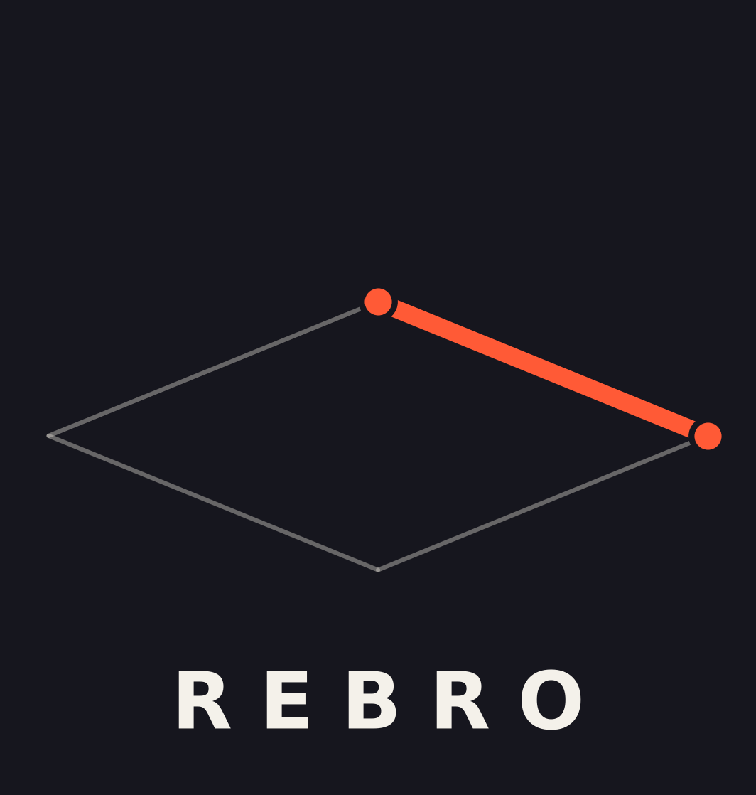

<p align="center">
  
</p>

<h1 align="center">Rebro</h1>

<p align="center">
  <b>A lightweight, high-performance 3D modeling editor built with C++20, Qt6, and OpenGL.</b>
</p>

<p align="center">
  
  
  
  
  
</p>

---

**Rebro** is a compact, native 3D editor designed for speed and clarity. It provides a clean interface for creating, editing, and exporting 3D models without the bloat of larger suites.

## ✨ Features

- **Full Modeling Suite:** Create primitives (cube, plane, sphere, cylinder, cone, torus) and edit them vertex-by-vertex.
- **Precise Manipulation:** Custom 3D gizmos for Move, Rotate, and Scale, with accurate raycasting for picking.
- **Real-time Feedback:** Hover highlighting, live vertex dragging, and smooth camera controls.
- **Undo / Redo:** Full command history with intelligent merging (e.g., dragging a slider counts as one action).
- **Materials & Textures:** Assign colors and image textures per object.
- **Native Project Format:** Save and load scenes to `.r3dp` with full transform, material, and geometry data.
- **Universal Import / Export:**
  - **Import:** OBJ, FBX, glTF, GLB (via Assimp)
  - **Export:** OBJ, glTF 2.0, GLB
- **Auto-backup:** Rotating backups every 60 seconds, stored safely next to the executable.
- **Multi-language UI:** Russian, English, Chinese, Arabic (RTL), Spanish, German, French, Japanese, Korean, Portuguese.
- **Themes:** Light and dark modes with smooth animated transitions.

## 🖥️ Screenshots

*(Add your screenshots here — a viewport with a model, the outliner, and the properties panel work best.)*

## 🛠️ Building from Source

### Requirements

- **C++20** compiler (GCC 10+, Clang 12+, MSVC 19.29+)
- **CMake** 3.20+
- **Qt6** (Widgets, OpenGLWidgets)
- **Assimp**
- **GLM** (bundled in `third_party/glm`)

### MSYS2 (Windows)

```bash
pacman -S mingw-w64-x86_64-{gcc,cmake,ninja,qt6-base,assimp}
git clone https://github.com/Hiss-Software/Rebro3D.git
cd Rebro3D
cmake -S . -B build -G Ninja
cmake --build build
```

The executable and all required DLLs will be placed in the `dist/` folder.

### Linux (Debian/Ubuntu)

```bash
sudo apt install build-essential cmake qt6-base-dev qt6-opengl-dev \
    libassimp-dev libglm-dev ninja-build
cmake -S . -B build -G Ninja
cmake --build build
```

## 🎮 Controls

| Action | Shortcut / Input |
|---|---|
| Move Object | `G` |
| Rotate Object | `R` |
| Scale Object | `Shift + S` |
| Edit Vertices | `V` |
| Delete Object | `Delete` |
| Undo / Redo | `Ctrl + Z` / `Ctrl + Y` |
| Move Camera | `W`, `A`, `S`, `D` |
| Camera Up / Down | `E` / `Q` |
| Orbit Camera | Hold Middle Mouse Button |
| Zoom | Scroll Wheel |
| Select Object | Left Click |
| Drag Vertex | Left Click + Drag (in Vertex mode) |

## 📦 Project Format (`.r3dp`)

The `.r3dp` format is a plain-text, human-readable scene format. It stores:
- Object names, transforms (position, rotation, scale)
- Material colors and texture paths
- Inline geometry for primitives and edited imports

This makes it easy to version-control scenes and inspect them manually.

## 📄 License

Distributed under the **MIT License**. See `LICENSE` for details.

---

<p align="center">
  <i>Created by <a href="https://github.com/Hiss-Software">Hiss-Software</a></i>
</p>